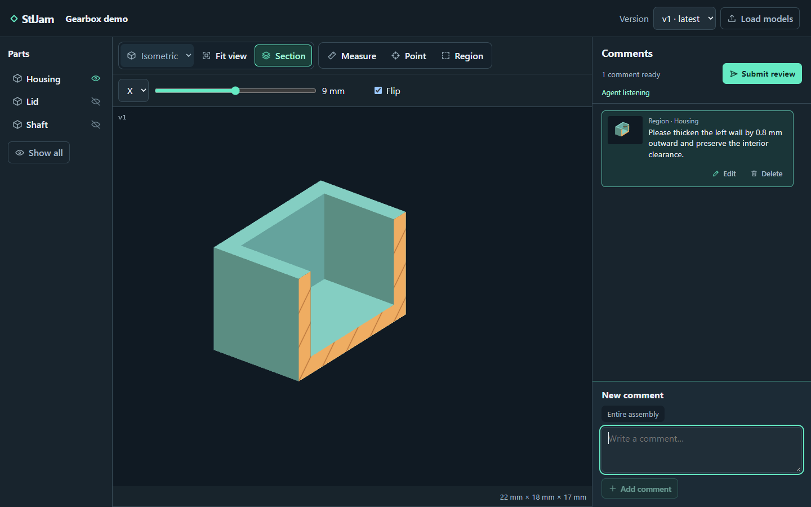

# StlJam

**Show your AI agent exactly what to change in a 3D model.**

“Make this wall thicker.” Which wall? With StlJam, you can point to it on the model, add a measurement or a note, and send that exact view with your feedback. When the agent publishes a revision, open the same link and compare it with the original.

StlJam runs locally in your browser and opens STL, 3MF, and GLB files. [Try the included gearbox demo](#quick-start) to mark up a model and compare two versions. The demo works without an AI agent.



## How it works

1. **Open a model.** Load your own files or review a preview your agent exported from CAD.
2. **Show what you mean.** Isolate a part, cut through it, mark a surface, or measure a gap. Your comment keeps the camera view and annotations.
3. **Send feedback and compare.** Submit your notes together. A connected agent can pick them up, edit the CAD source, and publish a new preview at the same link. The earlier version and its comments stay available.

See the [user guide](docs/guide.md) and the [GitHub wiki](https://github.com/satang/stljam/wiki) for more examples.

## Quick start

Install [Node.js 24 or later](https://nodejs.org/), then run:

```sh
git clone https://github.com/satang/stljam.git stljam
cd stljam
npm start
```

Open [StlJam](http://127.0.0.1:32410) and choose **Load models**. The viewer loads on your machine and the checkout has no npm runtime dependencies.

To use the CLI outside the checkout, install the `.tgz` from [GitHub Releases](https://github.com/satang/stljam/releases) with `npm install --global ./stljam-0.1.4.tgz`, then run `stljam serve`. Use `stljam demo` and `stljam demo --next` in place of the checkout commands below.

To try the review flow with the included synthetic gearbox, run this in a second terminal:

```sh
npm run demo
```

Open the URL printed by the command. Isolate the housing, turn on **Section**, and use **Point**, **Region**, or **Measure** to add context. Choose **Add comment** or press Enter to add a note to the list. Use **Submit review** to send the batch and close the round. Then publish the demo's edited housing:

```sh
node src/server/cli.mjs demo --next
```

The same page opens v2. **Compare** links the cameras, section plane, and part visibility. Open a comment on v1 to recover its saved view, annotation, and measurement. The demo thickens one wall outward from 2 to 2.8 mm while preserving its inner face.

## Connect an agent

Run the appropriate command from the StlJam checkout. Set `--workspace` to your CAD workspace using an absolute path.

**Codex**

```sh
codex mcp add stljam -- node "$PWD/src/server/cli.mjs" mcp --workspace "/absolute/path/to/cad-workspace"
```

**Claude Code**

```sh
claude mcp add --transport stdio stljam -- node "$PWD/src/server/cli.mjs" mcp --workspace "/absolute/path/to/cad-workspace"
```

The examples use a POSIX path. In PowerShell, replace the workspace argument with a Windows path such as `"C:\CAD\Gearbox"`. Start a new agent session after adding the server. Give the agent the [StlJam workflow](skills/stljam/SKILL.md) or try this prompt:

> Open my assembly in StlJam and reuse existing exports where possible. Share the review link and wait for my feedback. If the preview changes, publish the revision to the same link.

When the page says **Agent listening**, submitting the review returns the batch to the waiting agent in its current turn. If it has finished waiting, the batch stays available. Use **Copy** on the submitted review and tell the agent to apply the feedback. The agent can also recover it by batch ID.

## Publish an assembly

Use one preview file per selectable part or instance. A manifest preserves names, units, placement, and source references to the editable geometry.

```json
{
  "parts": [
    { "id": "housing", "label": "Housing", "file": "housing.stl", "units": "mm", "upAxis": "Z", "source": "gearbox.FCStd#Body", "group": ["Gearbox", "Enclosure"] },
    { "id": "lid", "label": "Lid", "file": "lid.stl", "units": "mm", "upAxis": "Z", "source": "gearbox.FCStd#Body001", "group": ["Gearbox", "Enclosure"] }
  ]
}
```

```sh
node src/server/cli.mjs publish gearbox manifest.json --workspace "/absolute/path/to/cad-workspace" --title "Gearbox" --request gearbox-v1
node src/server/cli.mjs feedback gearbox
node src/server/cli.mjs publish gearbox manifest.json --workspace "/absolute/path/to/cad-workspace" --base 1 --request gearbox-v2 --note "Thickened the left wall outward."
```

The manifest path is relative to the workspace. Each `file` is relative to the manifest. The optional `transform` is a column-major 4×4 matrix in millimeters, applied after converting the units and up axis. Keep part IDs stable across exports. STL defaults to millimeters and Z up. GLB defaults to meters and Y up. 3MF uses the embedded units unless the manifest overrides them.

For larger assemblies, set `group` to a path of names from parent to child. The Parts panel can expand each group and show or hide all its members together. Parts without a group appear at the top level.

### Exporters

- **FreeCAD** supports FCStd and STEP. Set `STLJAM_CAD_INPUT` and `STLJAM_CAD_OUTPUT`, then run `adapters/freecad/export_review.py` inside FreeCAD's Python environment with `MeshPart` available. Use `STLJAM_CAD_OBJECTS` for comma-separated internal object names. The default tessellation deflection is 0.05 mm.
- **Blender** exports self-contained GLB previews. Set `STLJAM_CAD_OUTPUT` and run `blender --background model.blend --python adapters/blender/export_review.py`. Use `STLJAM_CAD_OBJECTS` for comma-separated mesh object names.

## Local storage and geometry

StlJam listens on `127.0.0.1` and stores review metadata in SQLite and model snapshots and captures by content hash. The default data folder is `~/.stljam`. Set `--port` or `--data`, or use `STLJAM_PORT` and `STLJAM_DATA`. Use the same port and data directory for the browser server and the agent. Each exported version is a snapshot, so re-exporting a file under the same name preserves the older review.

Sections and measurements work on the preview mesh. Closed slice contours are filled, with holes preserved. Measurements are straight-line distances on tessellated geometry. Use your CAD tool for exact dimensions and model changes.

## Development

Run `npm test` for model ingestion, review round transitions, version snapshots, MCP over HTTP and stdio, listener state, and the section geometry. See the [architecture notes](docs/architecture.md) and [contribution guide](CONTRIBUTING.md).

StlJam is licensed under the [MIT License](LICENSE). See the [third-party notices](THIRD_PARTY_NOTICES.md) for bundled code.

## Origins and credits

[FrameJam](https://github.com/moritzkremb/framejam), created by [Moritz Kremb](https://github.com/moritzkremb), was the original inspiration for StlJam. Its video review workflow gives a person a preview to annotate and an AI agent a batch of feedback to act on. StlJam adapts that idea to 3D design, where feedback needs to refer to parts, surfaces, dimensions, and the view of a specific model revision.
