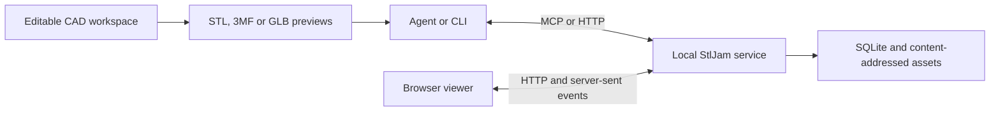

# Architecture

StlJam runs as one Node.js service on loopback. It serves a WebGL viewer and a local API, and hosts an MCP endpoint. The CLI can also act as an MCP stdio adapter to the same service. The browser and agent share one project store.

The review lifecycle adapts the feedback loop from [FrameJam](https://github.com/moritzkremb/framejam) by Moritz Kremb to versioned 3D previews. See the [user guide](guide.md) for the browser workflow.

## Review lifecycle

1. `open_review` opens an existing review or publishes a baseline manifest.
2. Each comment belongs to a specific model version. A comment may target the whole assembly, one part, a surface point, or a region. It can contain a camera, a section plane, part visibility, a mesh measurement, and a PNG capture.
3. `wait_for_feedback` and `get_feedback` deliver current submitted batches and record receipt. The shared service reports active listeners and receipt to the viewer. `start_revision` records which batch the agent started working on and the version it is preparing.
4. Submitting a batch closes its draft. A correction creates a replacement batch with an explicit `replaces` ID. Additional feedback creates an independent batch on the reviewed version. The review history preserves earlier submissions and withdrawals.
5. `add_version` publishes the revised previews with the base version, an idempotency key, and optional outcomes for the original comment IDs. A new version starts with an empty review. Publishing an outdated base returns a conflict.

## Geometry and annotations

The assembly uses millimeters and Z up. Local point coordinates and region samples are anchored to the part instance. Measurement endpoints are in assembly coordinates. The stored camera identifies the view used to interpret a region. IDs and transforms in the manifest keep exported geometry identifiable across versions. A revised mesh can change topology, so historical annotations reopen on the version they were made against.

The WebGL viewer clips triangles at the inspection plane. It triangulates closed cross-section contours, including holes, to display the exposed material. An open or non-manifold mesh may leave part of the cut unfilled. This operation changes the view. The CAD workspace owns geometry edits and exports.

## Boundaries

- The CLI and MCP stdio adapter can publish files by reading a manifest inside a registered workspace. Publishing through MCP HTTP uses the service's `STLJAM_WORKSPACE` setting. The file paths must resolve inside that workspace.
- The web API is intended for a single user's local machine. Treat reviews, their captures, and the data folder as local project material.
- `src/core` validates data and formats feedback. `src/server` owns HTTP, MCP, persistence and CLI. `src/web` contains the viewer. `adapters` contains optional exporters.
